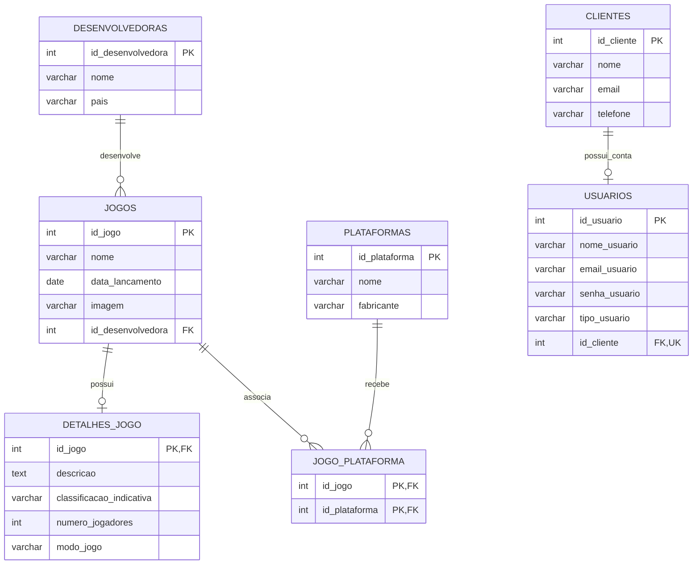

# Game Store

Projeto acadêmico de Desenvolvimento Web 1. Aplicação cliente-servidor para catálogo de jogos, desenvolvedoras, plataformas e clientes, usando Node.js, Express e PostgreSQL.

## Tecnologias
- HTML5, CSS3 e JavaScript
- Node.js e Express
- PostgreSQL e biblioteca `pg`
- Upload de capas com Multer
- Autenticação com cookies HttpOnly e hash de senha usando scrypt

## Organização
- `frontend/`: páginas HTML, estilos e JavaScript do navegador.
- `backend/controllers/`: regras de cada operação.
- `backend/routes/`: endpoints da API.
- `backend/middlewares/`: validação de sessão e autorização administrativa.
- `backend/utils/`: hash de senha e token de sessão.
- `backend/scripts/`: scripts auxiliares.
- `imagens/`: capas enviadas.

## Banco de dados
1. Crie um banco PostgreSQL chamado `gamestore` (ou ajuste `DB_NAME`).
2. Execute o arquivo `jvb_3bim_lojadegames.sql` no banco.
3. O SQL cria desenvolvedoras, plataformas, jogos, detalhes_jogo, jogo_plataforma, clientes e usuarios, com dados de exemplo.

O modelo contém relacionamentos 1:N entre desenvolvedoras e jogos, 1:1 entre jogos e detalhes_jogo, N:N entre jogos e plataformas, e 1:1 opcional entre clientes e usuarios.


## Diagrama do banco



A relação entre `CLIENTES` e `USUARIOS` é opcional do lado do usuário administrativo: contas de cliente precisam apontar para um cliente; contas de administrador não possuem `id_cliente`.

## Configuração
1. Instale Node.js LTS e PostgreSQL.
2. Na raiz do projeto, execute `npm install`.
3. Copie `.env.example` para `.env`.
4. Preencha as variáveis de conexão com o seu PostgreSQL.
5. Gere um valor aleatório longo para `COOKIE_SECRET`; não reutilize o exemplo.
6. Defina `ADMIN_EMAIL` e uma senha forte em `ADMIN_INITIAL_PASSWORD`.

## Criar administrador
Depois de executar o SQL e configurar o `.env`, execute:

```bash
npm run admin:criar
```

O script cria uma conta com perfil `admin`. Se o e-mail já existir, não altera a conta. Não coloque senhas reais no GitHub.

## Executar
Inicie o backend:

```bash
npm run dev
```

A API ficará disponível em `http://localhost:3001`. Abra o frontend usando uma extensão de servidor local do editor (por exemplo, Live Server) e acesse `frontend/login.html`.

## Áreas do sistema
- `frontend/catalogo.html`: catálogo público para visitantes e clientes, com busca e visualização dos detalhes dos jogos.
- `frontend/minha-conta.html`: área autenticada do cliente, com identificação da conta e acesso ao catálogo.
- `frontend/admin.html`: painel restrito ao administrador, com atalhos para os CRUDs existentes.
- `frontend/login.html`: login e cadastro de clientes.

As páginas de gerenciamento (`jogos.html`, `plataformas.html`, `desenvolvedoras.html` e `clientes.html`) redirecionam quem não tem perfil administrativo. A API também valida o perfil, então esconder links na interface não é a única proteção.

## Autenticação e permissões
- Cadastro público cria uma conta do tipo `cliente) e o registro correspondente em `clientes`.
- Login valida a senha no servidor e emite cookie `HttpOnly`.
- A API consulta o usuário no banco em cada requisição autenticada.
- Operações de criação, edição e exclusão do catálogo exigem perfil `admin`.
- Consultas públicas do catálogo permanecem disponíveis.
- Logout limpa o cookie de sessão.

## Contas de teste do SQL
Os 12 usuários de teste inseridos pelo SQL usam temporariamente a senha `GameStore@123`. Troque/remova essas contas antes de colocar o projeto em produção. O administrador é criado separadamente pelo script.

## Segurança importante
O arquivo `.env` não deve ser versionado. Se credenciais reais já foram publicadas no repositório, altere imediatamente as senhas/segredos no serviço correspondente. Adicionar `.env` ao `.gitignore` impede novos commits, mas não remove versões antigas do histórico Git.
